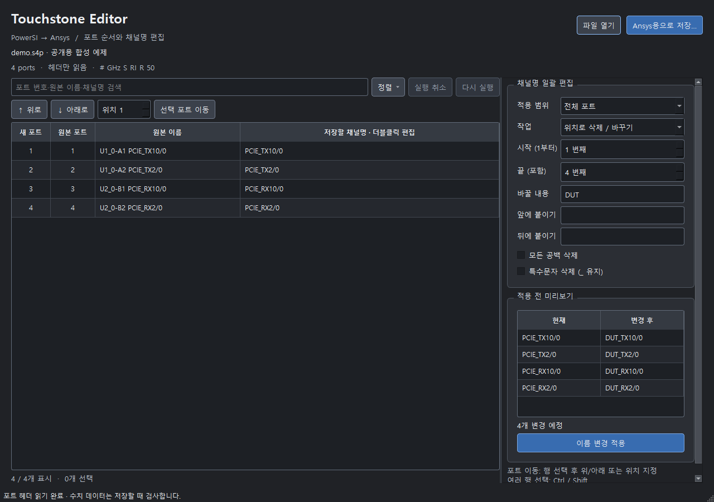

# Touchstone Editor

PowerSI에서 만든 Touchstone 파일을 Ansys용 포트 주석으로 변환하는 Windows 앱.
채널명 일괄 편집과 포트 순서 변경 지원.



## 설치

1. [최신 릴리스](https://github.com/yunhyok/touchstone-editor/releases/latest)에서 `Touchstone-Editor-Setup-v1.2.0-x64.exe` 다운로드.
2. 설치 프로그램 실행. 기본 경로 `C:\Program Files\Touchstone Editor`.
3. 설치 경로 화면에서 다른 드라이브·폴더 선택 가능.
4. 시작 메뉴의 **Touchstone Editor** 실행.

Windows 10 1809 이상 / Windows 11 x64용. Python 별도 설치 불필요. 설치 시 관리자 권한 필요.
현재 배포 파일은 코드 서명 없음.

## 주요 기능

| 기능 | 동작 |
|---|---|
| Ansys용 주석 | `! Port 1 = U1-A1 CH/0` → `! Port[1] = CH/0` |
| 채널명 정렬 | 숫자 순서를 반영한 정렬. `CH2` 다음 `CH10` |
| 수동 순서 변경 | 단일·다중 선택, 위/아래 이동, 지정 위치 이동 |
| 개별 이름 편집 | 저장할 채널명 셀 더블클릭 |
| 일괄 이름 편집 | 문자 위치 범위 삭제·치환, 찾기/바꾸기, 정규식 치환, 지정 문자 삭제, 구분자 앞/뒤 유지, 부품 정보 제거 |
| 이름 정리 | 공백 삭제, 특수문자 삭제, 접두사·접미사 추가 |
| 적용 전 확인 | 전체 또는 선택 포트 대상 미리보기, 실행 취소/다시 실행 |
| 대용량 처리 | 열 때 앞쪽 헤더만 읽기. 저장 시 주파수 지점 단위 처리, 진행률·취소 지원 |

## 사용 순서

1. **파일 열기**: `.sNp` 파일 선택. 예: 80포트는 `.s80p`.
2. **원본 이름**과 **저장할 채널명** 비교. PowerSI 번호형 포트 주석의 첫 부품·핀 토큰은 자동 제거. 예: `U1-A1`, `LGA-QB1380`, `Z0-3K23`.
3. **정렬** 메뉴에서 채널명 정렬 또는 행 선택 후 수동 이동.
4. 일괄 편집에서 범위·작업·문자열 설정. **미리보기** 확인 후 **이름 변경 적용**.
5. **Ansys용으로 저장…**: 원본과 다른 경로에 저장.

검색은 표시할 행만 제한. **전체 포트** 편집과 정렬은 검색으로 숨겨진 포트에도 적용.
수동 위치 이동은 검색 해제 후 사용. 여러 포트는 Ctrl/Shift로 선택.
지정 위치는 이동 후 선택 묶음의 첫 포트 위치. 마지막 범위를 넘으면 끝으로 이동.
작은 창에서는 포트 표와 일괄 편집을 탭으로 분리. 원본 이름 열은 숨김.
채널명 셀에 마우스를 올리면 원본 이름 확인 가능.

구분자 앞/뒤 유지 작업은 **첫 번째 구분자** 기준. **찾아 바꾸기**는 일반 문자열, **정규식 찾아 바꾸기**는 PCRE2 검색식 사용.
특수문자 삭제는 문자·숫자·밑줄(`_`) 유지. 접두사·접미사는 정리 작업 이후 추가.
이름 앞뒤 공백은 저장 형식에 맞춰 제거. 이름 변경을 적용하면 편집 조건 초기화.
실행 취소는 `Ctrl+Z`, 다시 실행은 `Ctrl+Y`.

### 문자 위치로 삭제·변경

작업에서 **위치로 삭제 / 바꾸기** 선택. 현재 **저장할 채널명**의 왼쪽 첫 문자를 1로 계산. 시작·끝 위치 모두 포함.
**바꿀 내용**을 비워 두면 해당 범위 삭제. 문자열을 입력하면 해당 범위 전체를 입력한 문자열로 변경.

| 현재 채널명 | 시작 | 끝 | 바꿀 내용 | 결과 |
|---|---|---|---|---|
| `ABC_CHANNEL` | 1 | 4 | 비움 | `CHANNEL` |
| `ABC_CHANNEL` | 1 | 3 | `DUT` | `DUT_CHANNEL` |
| `ABCDEFG` | 2 | 4 | `X` | `AXEFG` |

- 끝 위치가 이름 길이를 넘으면 마지막 문자까지 처리. 시작 위치부터 이름 길이를 넘으면 해당 이름의 범위 치환 생략.
- 공백·특수문자도 위치 계산에 포함. 바이트가 아닌 Unicode 코드 포인트 기준. 한글 완성형과 일반 이모지는 각각 1문자, 결합 문자는 구성 코드 포인트별 계산.
- 적용 범위는 전체 또는 선택한 포트. 접두사·접미사와 공백·특수문자 정리는 범위 치환 후 적용.
- 시작보다 작은 끝 위치 또는 빈 이름이 생기는 작업은 적용 차단. **미리보기** 확인 후 적용할 것.

### 정규식 이름 변경 예시

괄호로 묶은 부분은 치환문에서 `$1`, `$2`로 사용. 달러 문자 자체는 `$$`로 입력할 것.

| 원래 채널명 | 찾을 정규식 | 바꿀 문자열 | 결과 |
|---|---|---|---|
| `SITE12-DQ0` | `^SITE([0-9]+)-(.*)$` | `FIXTURE-$2/$1` | `FIXTURE-DQ0/12` |
| `U3_DQ0` | `^U([0-9]+)_(.*)$` | `L$1-$2` | `L3-DQ0` |

서로 다른 포트 묶음은 **선택 포트** 범위로 나누어 적용. 검색에서 원본 부품명도 검색 가능.
잘못된 검색식·없는 그룹 번호·과도한 검색 연산은 오류로 표시하며 적용 차단.

## 데이터 보존

- 파일 열기는 선두 주석·옵션 헤더와 종료 경계 1바이트만 읽음. 전체 파일 해시·수치 데이터 검사 없음.
- 수치 데이터 유효성 검사는 **저장할 때** 수행. 저장 완료 전까지 주파수 지점 수 미확정.
- 이름만 변경할 때 수치 데이터 바이트 유지.
- 포트 순서 변경 시 S 행렬의 **행과 열을 함께 재배열**.
- 수치 문자열을 실수로 변환해 다시 쓰지 않으므로 유효 숫자 유지.
- RI·MA·DB 형식, 주파수 단위, 기준 임피던스 유지.
- 원본 덮어쓰기 차단. 임시 파일 작성 성공 후에만 출력 파일 교체.
- 잘린 수치 데이터·지원하지 않는 형식·변경이 감지된 원본은 저장 중단.
- 원본의 파일 ID·크기·수정 시각과 읽은 헤더 해시로 변경 감지. 동일 ID·크기·수정 시각을 유지한 수치 데이터 변경은 감지 불가. 편집 중 원본을 다른 프로그램에서 수정하지 말 것.
- 순서·이름 변경 시 기존 연결에 종속된 PowerSI 보조 포트/NETSLIST 및 `!.DiffChannels` 블록 제거. 기본 주석 변환에서는 해당 블록 보존.
- 순서 변경 시 수치 데이터 사이·이후의 주석 제거. 행 위치에 종속된 설명의 잘못된 연결 방지.
- 중복 이름 허용. 포트 번호로 구분되므로 미리보기에서 중복 여부 확인 필요.

## 지원 범위와 검증 경계

Touchstone 1.x의 전체 행렬 S-parameter 파일 지원. RI / MA / DB와 Hz / kHz / MHz / GHz 지원.
Touchstone 2.x, 혼합 모드, 압축 삼각 행렬, 잡음 데이터는 지원하지 않음.
지원하지 않는 파일은 자동 추정 변환하지 않고 오류로 표시.
포트 번호는 파일 앞쪽의 `! Port N =` 또는 `! Port[N] =` 주석 기준. PowerSI 보조 `PortN_...::`의 번호는 행렬 순서로 사용하지 않음.
포트 정보가 수치 데이터 뒤에 나오는 파일과 옵션 줄이 여러 개인 파일은 지원하지 않음.
HFSS `Gamma` / `Port Impedance` 확장 주석이 있으면 이름 변경만 지원. 포트 재배열은 중단.
단일 물리적 줄은 최대 16MiB 지원.

제공된 PowerSI/Ansys 80포트 참조 파일의 포트 주석 변환 규칙과 수치 데이터 일치를 기준으로 구현.
v1.1.0 추가 검증: 256·505포트 예제 6개의 선두 헤더만 읽어 포트명 2,034개 확인. 추가 예제의 수치 데이터 본문은 읽거나 변환하지 않음.
행렬 재배열·숫자 문자열 보존·잘린 파일 거부·취소 시 출력 보존은 합성 데이터로 검사.
**Ansys Circuit Designer에서의 실제 가져오기 검증은 별도 필요.**
측정 원본과 사용자 장치 정보는 공개 저장소에 포함하지 않음.

## 소스 실행 및 빌드

Python 3.12 x64, Windows, Inno Setup 6 필요.

```powershell
python -m venv .venv
.\.venv\Scripts\Activate.ps1
python -m pip install -r requirements-build.txt
python run_app.py
python -m pytest
powershell -ExecutionPolicy Bypass -File .\scripts\build.ps1
```

파일을 지정해 실행 가능: `python run_app.py "D:\example.s4p"`.
빌드 결과: `dist/Touchstone-Editor-Setup-v1.2.0-x64.exe`.
아이콘 재생성: `python scripts/make_icon.py`.
GitHub Actions에서 테스트·Windows 빌드 수행. `v1.0.0` 형식의 태그로 릴리스 생성.

## 참고

- [IBIS Touchstone 공식 규격](https://ibis.org/touchstone_ver2.1/touchstone_ver2_1.pdf)
- 앱: [MIT License](LICENSE)
- Qt 및 배포 런타임: [Third-party notices](THIRD_PARTY_NOTICES.md)
