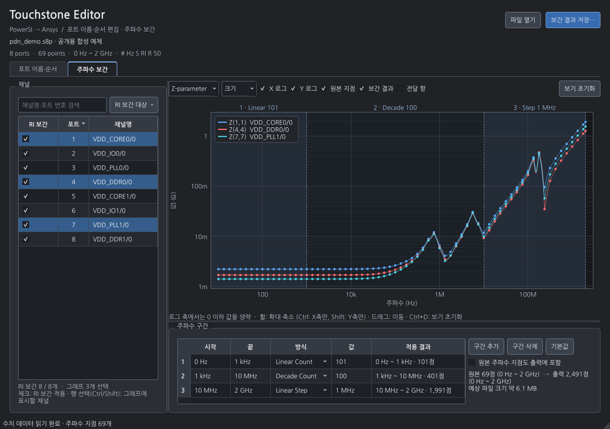

# Touchstone Editor

PowerSI에서 만든 Touchstone 파일을 Ansys용 포트 주석으로 변환하는 Windows 앱.
채널명 일괄 편집, 포트 순서 변경, 주파수 구간별 보간(Interpolation)과 S·Z 그래프 지원.




## 설치

1. [최신 릴리스](https://github.com/yunhyok/touchstone-editor/releases/latest)에서 `Touchstone-Editor-Setup-v1.3.0-x64.exe` 다운로드.
2. 설치 프로그램 실행. 기본 경로 `C:\Program Files\Touchstone Editor`.
3. 설치 경로 화면에서 다른 드라이브·폴더 선택 가능.
4. 시작 메뉴의 **Touchstone Editor** 실행.

Windows 10 1809 이상 / Windows 11 x64용. Python 별도 설치 불필요. 설치 시 관리자 권한 필요.
현재 배포 파일은 코드 서명 없음.

## 주요 기능

| 기능 | 동작 |
|---|---|
| Ansys용 주석 | `! Port 1 = U1-A1 CH/0` → `! Port[1] = CH/0` |
| 채널명 정렬 | 숫자 순서를 반영한 정렬. `CH2` 다음 `CH10` |
| 수동 순서 변경 | 단일·다중 선택, 위/아래 이동, 지정 위치 이동 |
| 개별 이름 편집 | 저장할 채널명 셀 더블클릭 |
| 일괄 이름 편집 | 문자 위치 범위 삭제·치환, 찾기/바꾸기, 정규식 치환, 지정 문자 삭제, 구분자 앞/뒤 유지, 부품 정보 제거 |
| 이름 정리 | 공백 삭제, 특수문자 삭제, 접두사·접미사 추가 |
| 적용 전 확인 | 전체 또는 선택 포트 대상 미리보기, 실행 취소/다시 실행 |
| 대용량 처리 | 열 때 앞쪽 헤더만 읽기. 저장 시 주파수 지점 단위 처리, 진행률·취소 지원 |
| 주파수 보간 | 구간별 Linear Count / Decade Count / Linear Step 지점으로 재표본화 후 병합 저장 |
| RI 보간 | 선택한 채널에 실수·허수 선형 보간 적용. `INTDATTYP=RI` 지정과 같은 계산 |
| 그래프 | S·Z 변환, 크기·dB·위상·실수·허수, 축별 log/lin, 휠 확대·드래그 이동·`Ctrl+D` 원복 |

## 사용 순서

1. **파일 열기**: `.sNp` 파일 선택. 예: 80포트는 `.s80p`.
2. **원본 이름**과 **저장할 채널명** 비교. PowerSI 번호형 포트 주석의 첫 부품·핀 토큰은 자동 제거. 예: `U1-A1`, `LGA-QB1380`, `Z0-3K23`.
3. **정렬** 메뉴에서 채널명 정렬 또는 행 선택 후 수동 이동.
4. 일괄 편집에서 범위·작업·문자열 설정. **미리보기** 확인 후 **이름 변경 적용**.
5. **Ansys용으로 저장…**: 원본과 다른 경로에 저장.

기능은 **포트 이름·순서**와 **주파수 보간** 두 탭으로 분리. 오른쪽 위 저장 버튼은 현재 탭의 결과를 저장.
파일은 창에 끌어다 놓아도 열림. 저장 단축키 `Ctrl+S`.

검색은 표시할 행만 제한. **전체 포트** 편집과 정렬은 검색으로 숨겨진 포트에도 적용.
수동 위치 이동은 검색 해제 후 사용. 여러 포트는 Ctrl/Shift로 선택.
지정 위치는 이동 후 선택 묶음의 첫 포트 위치. 마지막 범위를 넘으면 끝으로 이동.
작은 창에서는 포트 표와 일괄 편집을 탭으로 분리. 원본 이름 열은 숨김.
채널명 셀에 마우스를 올리면 원본 이름 확인 가능.

구분자 앞/뒤 유지 작업은 **첫 번째 구분자** 기준. **찾아 바꾸기**는 일반 문자열, **정규식 찾아 바꾸기**는 PCRE2 검색식 사용.
특수문자 삭제는 문자·숫자·밑줄(`_`) 유지. 접두사·접미사는 정리 작업 이후 추가.
이름 앞뒤 공백은 저장 형식에 맞춰 제거. 이름 변경을 적용하면 편집 조건 초기화.
실행 취소는 `Ctrl+Z`, 다시 실행은 `Ctrl+Y`.

### 문자 위치로 삭제·변경

작업에서 **위치로 삭제 / 바꾸기** 선택. 현재 **저장할 채널명**의 왼쪽 첫 문자를 1로 계산. 시작·끝 위치 모두 포함.
**바꿀 내용**을 비워 두면 해당 범위 삭제. 문자열을 입력하면 해당 범위 전체를 입력한 문자열로 변경.

| 현재 채널명 | 시작 | 끝 | 바꿀 내용 | 결과 |
|---|---|---|---|---|
| `ABC_CHANNEL` | 1 | 4 | 비움 | `CHANNEL` |
| `ABC_CHANNEL` | 1 | 3 | `DUT` | `DUT_CHANNEL` |
| `ABCDEFG` | 2 | 4 | `X` | `AXEFG` |

- 끝 위치가 이름 길이를 넘으면 마지막 문자까지 처리. 시작 위치부터 이름 길이를 넘으면 해당 이름의 범위 치환 생략.
- 공백·특수문자도 위치 계산에 포함. 바이트가 아닌 Unicode 코드 포인트 기준. 한글 완성형과 일반 이모지는 각각 1문자, 결합 문자는 구성 코드 포인트별 계산.
- 적용 범위는 전체 또는 선택한 포트. 접두사·접미사와 공백·특수문자 정리는 범위 치환 후 적용.
- 시작보다 작은 끝 위치 또는 빈 이름이 생기는 작업은 적용 차단. **미리보기** 확인 후 적용할 것.

### 정규식 이름 변경 예시

괄호로 묶은 부분은 치환문에서 `$1`, `$2`로 사용. 달러 문자 자체는 `$$`로 입력할 것.

| 원래 채널명 | 찾을 정규식 | 바꿀 문자열 | 결과 |
|---|---|---|---|
| `SITE12-DQ0` | `^SITE([0-9]+)-(.*)$` | `FIXTURE-$2/$1` | `FIXTURE-DQ0/12` |
| `U3_DQ0` | `^U([0-9]+)_(.*)$` | `L$1-$2` | `L3-DQ0` |

서로 다른 포트 묶음은 **선택 포트** 범위로 나누어 적용. 검색에서 원본 부품명도 검색 가능.
잘못된 검색식·없는 그룹 번호·과도한 검색 연산은 오류로 표시하며 적용 차단.

## 주파수 보간

Ansys Circuit Designer의 N-port 모델은 파일에 없는 주파수의 값을 보간해서 사용.
Edit Model → Options → Additional Options에 `INTDATTYP=RI`를 넣으면 S-parameter의 실수·허수를 선형 보간.
**주파수 보간** 탭은 같은 계산을 파일에 미리 적용. 해석에 쓸 주파수 지점을 구간별로 만들고 각 지점의 값을 채워 저장.
출력 파일의 지점과 해석 지점이 같으면 Ansys 쪽 보간 설정과 무관하게 같은 값 사용.

### 사용 순서

1. 파일을 연 뒤 **주파수 보간** 탭 선택. 256MB 이하 파일은 수치 데이터를 자동으로 읽음. 더 큰 파일은 **수치 데이터 불러오기** 버튼 사용.
2. **주파수 구간** 표에서 구간 추가·삭제, 시작·끝 주파수와 방식·값 수정. 주파수 입력 예: `0`, `1k`, `10MHz`, `2G`.
3. **채널** 표에서 RI 보간을 적용할 채널 체크. 기본값은 전체 체크.
4. 그래프에서 원본 지점(점)과 보간 결과(선) 확인.
5. **보간 결과 저장…**: 원본과 다른 경로에 저장. 포트 이름·순서 탭의 편집 내용도 함께 반영.

### 주파수 구간

| 방식 | 값의 의미 | 기본 구간 |
|---|---|---|
| Linear Count | 구간 전체의 지점 수. 양 끝 포함, 등간격 | 0 ~ 1kHz, 101 |
| Decade Count | decade당 지점 수. 로그 등간격. 시작 주파수는 0보다 커야 함 | 1kHz ~ 10MHz, 100 |
| Linear Step | 주파수 간격 | 10MHz ~ 2GHz, 1MHz |

- 기본 구간을 0 ~ 2GHz 이상의 원본에 적용하면 101 + 400 + 1,990 = 2,491개 지점. 구간 경계의 중복 지점은 하나로 병합.
- 원본 주파수 범위를 벗어난 부분은 사용하지 않음. 범위 밖으로 값을 추정(extrapolation)하지 않음.
  - Linear Count: 원본 범위 안으로 줄인 구간에 같은 개수의 지점을 다시 배치.
  - Decade Count·Linear Step: 원래 구간의 시작을 기준으로 한 지점 위치 유지. 줄어든 구간의 양 끝 지점 추가.
  - 원본 범위와 겹치지 않는 구간은 **원본 범위 밖**으로 표시하고 제외.
- **적용 결과** 열과 그래프의 음영 구역에서 실제 적용 범위와 지점 수 확인.
- **원본 주파수 지점도 출력에 포함**: 구간 지점에 더해 원본의 모든 주파수 지점을 원래 값으로 유지.
- 표 아래에 출력 지점 수와 예상 파일 크기 표시. 포트 수의 제곱에 비례하므로 저장 전 확인 필요. 1GB 이상이면 저장 전 확인 창 표시.

### 채널 선택과 보간 방식

- **RI 보간** 열 체크: 해당 채널(포트)이 행 또는 열에 포함된 모든 S 항에 실수·허수 선형 보간 적용.
- 체크하지 않은 채널끼리의 항: 크기 선형 보간과 위상 선형 보간(가까운 방향으로 회전) 적용. 크기·위상(MA) 기준 보간에 해당.
  한쪽 값이 0이면 다른 쪽의 위상 사용.
- 출력 지점이 원본 주파수와 같으면 모든 채널이 원본 숫자 문자열 그대로 기록. 선택 여부와 무관.
- 표 머리글 클릭으로 정렬. 채널명은 숫자 순서 반영. 검색으로 표시 채널 제한. `Space`로 선택한 행의 체크 전환.
- **RI 보간 대상** 메뉴: 전체 체크·해제, 선택한 채널만 체크.

### 그래프

- 표에서 선택한 채널만 표시. `Ctrl`·`Shift`로 여러 채널 선택. 선택이 없으면 검색 결과 전체 표시.
- 기본 표시는 각 채널의 자기 항(`Z(n,n)` 또는 `S(n,n)`). **전달 항** 체크 시 선택한 2~8개 채널 사이의 항도 표시.
- **Z-parameter / S-parameter** 전환. Z는 보간한 S 행렬 전체를 변환한 값. 포트 수가 많으면 계산 시간 필요, 진행률 표시.
- 표시 값: 크기, dB, 위상, 실수, 허수. **X 로그**·**Y 로그**로 축별 log/lin 전환. 로그 축은 0 이하 값을 그리지 않음.
- 마우스 휠: 커서 위치 기준 확대·축소. `Ctrl`+휠은 X축만, `Shift`+휠은 Y축만. 축 눈금 위에서 휠을 돌려도 해당 축만 변경.
- 드래그: 이동. `Ctrl+D`, 더블클릭, **보기 초기화**: 기본 위치·크기로 원복.
- 점 위에 커서를 올리면 채널·주파수·값 표시. 음영 구역과 위쪽 이름표는 주파수 구간.

## 데이터 보존

- 파일 열기는 선두 주석·옵션 헤더와 종료 경계 1바이트만 읽음. 전체 파일 해시·수치 데이터 검사 없음.
- 수치 데이터 유효성 검사는 **저장할 때** 수행. 저장 완료 전까지 주파수 지점 수 미확정.
- 이름만 변경할 때 수치 데이터 바이트 유지.
- 포트 순서 변경 시 S 행렬의 **행과 열을 함께 재배열**.
- 수치 문자열을 실수로 변환해 다시 쓰지 않으므로 유효 숫자 유지.
- RI·MA·DB 형식, 주파수 단위, 기준 임피던스 유지.
- 원본 덮어쓰기 차단. 임시 파일 작성 성공 후에만 출력 파일 교체.
- 잘린 수치 데이터·지원하지 않는 형식·변경이 감지된 원본은 저장 중단.
- 원본의 파일 ID·크기·수정 시각과 읽은 헤더 해시로 변경 감지. 동일 ID·크기·수정 시각을 유지한 수치 데이터 변경은 감지 불가. 편집 중 원본을 다른 프로그램에서 수정하지 말 것.
- 순서·이름 변경 시 기존 연결에 종속된 PowerSI 보조 포트/NETSLIST 및 `!.DiffChannels` 블록 제거. 기본 주석 변환에서는 해당 블록 보존.
- 순서 변경 시 HFSS `Gamma`·`Port Impedance`의 포트별 복소수 쌍도 재배열. 숫자 표기와 주파수 연결 유지.
- 순서 변경 시 수치 데이터 사이·이후의 나머지 주석 제거. 행 위치에 종속된 설명의 잘못된 연결 방지.
- 중복 이름 허용. 포트 번호로 구분되므로 미리보기에서 중복 여부 확인 필요.
- 보간 저장은 원본을 다시 읽으며 기록. 원본 주파수와 같은 지점은 숫자 문자열 유지, 새 지점만 유효 숫자 15자리로 계산해 기록.
- 보간 저장 시 RI·MA·DB 형식, 주파수 단위, 기준 임피던스 유지. 보간 내용은 헤더 주석 두 줄로 기록.
- 보간 저장 시 수치 데이터 사이·이후의 주석(HFSS `Gamma`·`Port Impedance` 포함) 제거. 주파수 지점이 달라져 원래 연결이 성립하지 않음.
- 수치 데이터를 읽은 뒤 원본 파일이 바뀌면 보간 저장 중단.

## 지원 범위와 검증 경계

Touchstone 1.x의 전체 행렬 S-parameter 파일 지원. RI / MA / DB와 Hz / kHz / MHz / GHz 지원.
옵션 줄에 생략된 항목은 규격 기본값(`GHz`, `MA`, `R 50`) 적용.
Touchstone 2.x, 혼합 모드, 압축 삼각 행렬, 잡음 데이터는 지원하지 않음.
지원하지 않는 파일은 자동 추정 변환하지 않고 오류로 표시.
포트 번호는 파일 앞쪽의 `! Port N =` 또는 `! Port[N] =` 주석 기준. PowerSI 보조 `PortN_...::`의 번호는 행렬 순서로 사용하지 않음.
포트 정보가 수치 데이터 뒤에 나오는 파일과 옵션 줄이 여러 개인 파일은 지원하지 않음.
HFSS `Gamma` / `Port Impedance` 확장 주석은 완전한 주파수 지점 뒤에 각 항목이 **한 줄에 포트 수 × 2개의 숫자**로 기록된 형식의 재배열 지원.
여러 줄로 나뉜 블록, 전체 임피던스 행렬, 불완전하거나 수치 데이터와 같은 줄에 있는 확장 주석은 재배열 중단. 이름만 변경할 때는 원래 주석 보존.
단일 물리적 줄은 최대 16MiB 지원.

제공된 PowerSI/Ansys 80포트 참조 파일의 포트 주석 변환 규칙과 수치 데이터 일치를 기준으로 구현.
v1.1.0 추가 검증: 256·505포트 예제 6개의 선두 헤더만 읽어 포트명 2,034개 확인. 추가 예제의 수치 데이터 본문은 읽거나 변환하지 않음.
v1.2.1 오류 수정 검증: Circuit Design 2023.2에서 내보낸 260포트 파일을 채널명 순으로 정렬·저장. 560개 주파수의 행렬 37,856,000개 복소수 항목과 Gamma·임피던스 값을 원본과 대조하여 재배열 및 숫자 문자열 보존 확인.
행렬 재배열·숫자 문자열 보존·잘린 파일 거부·취소 시 출력 보존은 합성 데이터로 검사.
v1.3.0 주파수 보간 검증: 구간 지점 생성, RI·크기/위상 보간값, RI·MA·DB 형식 왕복, 2포트 순서, 포트 재배열 동시 적용을 합성 데이터로 검사.
S→Z 변환은 scikit-rf 2.2.0의 `s2z` 결과와 대조(포트별 기준 임피던스 포함, 상대 오차 1e-14 이하). 260포트 합성 파일로 처리 시간 확인.
보간 방식의 근거는 HSPICE 호환 S-element의 `INTDATTYP` 정의(RI: 실수·허수, MA: 크기·위상, DBA: dB·위상 기준 선형 보간).
**Ansys Circuit Designer의 `INTDATTYP=RI` 결과와 수치를 직접 대조하지 않음.** Ansys 내부 보간의 세부 동작(위상 처리, 범위 밖 처리)은 확인하지 못함.
보간은 원본 지점 사이를 직선으로 잇는 계산. 원본 지점이 드문 구간의 공진 형상은 복원하지 않음.
Z 변환은 실수 기준 임피던스 가정: `Z = √R (I − S)⁻¹ (I + S) √R`.
수치 데이터 전체를 메모리에 올려 미리보기 계산(주파수 지점 수 × 포트 수² × 16바이트). 여유 메모리의 60%를 넘으면 그래프 생략, 구간 설정과 저장은 사용 가능.
**Ansys Circuit Designer에서의 실제 가져오기 검증은 별도 필요.**
측정 원본과 사용자 장치 정보는 공개 저장소에 포함하지 않음.

## 소스 실행 및 빌드

Python 3.12 x64, Windows, Inno Setup 6 필요. 실행 의존성은 PySide6와 NumPy.

```powershell
python -m venv .venv
.\.venv\Scripts\Activate.ps1
python -m pip install -r requirements-build.txt
python run_app.py
python -m pytest
powershell -ExecutionPolicy Bypass -File .\scripts\build.ps1
```

파일을 지정해 실행 가능: `python run_app.py "D:\example.s4p"`.
빌드 결과: `dist/Touchstone-Editor-Setup-v1.3.0-x64.exe`.
아이콘 재생성: `python scripts/make_icon.py`.
GitHub Actions에서 테스트·Windows 빌드 수행. `v1.0.0` 형식의 태그로 릴리스 생성.
태그 없이 릴리스하려면 Actions의 **Windows** 워크플로를 `main`에서 수동 실행하고 `release` 선택. `pyproject.toml`의 버전으로 태그와 릴리스 생성.

## 참고

- [IBIS Touchstone 공식 규격](https://ibis.org/touchstone_ver2.1/touchstone_ver2_1.pdf)
- [Ansys Gamma·임피던스 확장 주석 설명](https://ansyshelp.ansys.com/public/Views/Secured/Electronics/v242/en/Subsystems/HFSS3DLayout/Content/ReportsandPostProc/ExportingMatrixData.htm)
- [S→Z 변환 대조에 사용한 scikit-rf](https://github.com/scikit-rf/scikit-rf)
- 앱: [MIT License](LICENSE)
- Qt, NumPy 및 배포 런타임: [Third-party notices](THIRD_PARTY_NOTICES.md)
